<p align="center">
  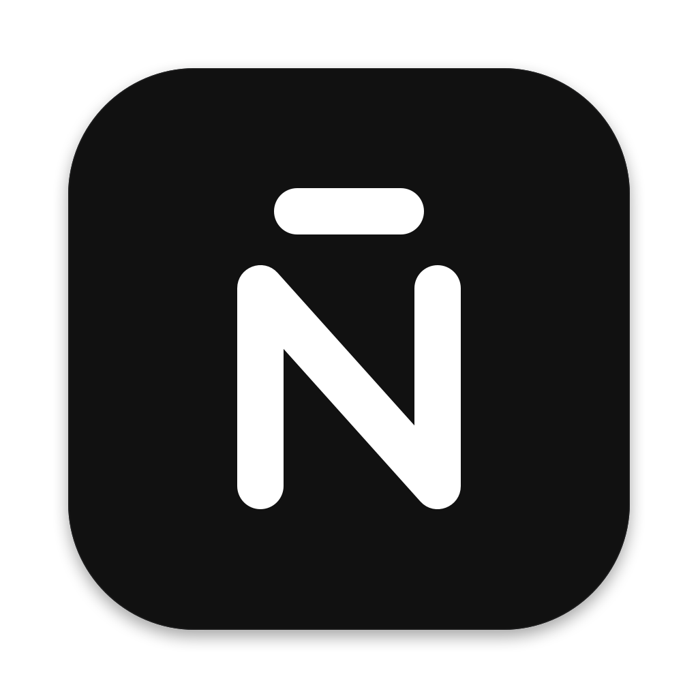
</p>

<h1 align="center">TinyNotch</h1>

<p align="center">
  <a href="README.md">English</a> · <b>Русский</b>
</p>

<p align="center">
  Превращает вырез MacBook в интерактивный островок — музыка, задачи, заметки, таймеры, напоминания,
  буфер обмена, файлы, сто встроенных инструментов и слежка за ИИ-агентами, на расстоянии наведения курсора.
  Нативный SwiftUI, без Electron и без Xcode.
</p>


<p align="center">
  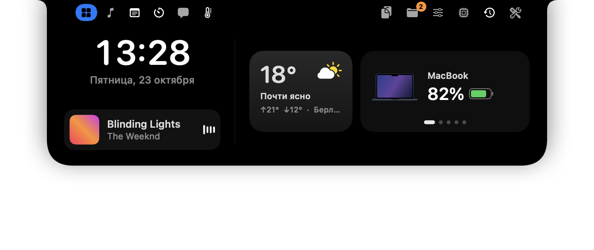
</p>

## Содержание

- [Скачать](#скачать)
- [Как это работает](#как-это-работает)
- [Возможности](#возможности) — [Главное](#главное) · [Музыка](#музыка) · [Заметки и задачи](#заметки-и-задачи) · [Таймер](#таймер-помодоро-и-будильники) · [Напоминания](#напоминания) · [AirPods и батареи](#airpods-и-батареи) · [Управление](#управление) · [Файлы](#файлы) · [Буфер обмена](#буфер-обмена) · [Инструменты: 100 в островке](#инструменты-100-в-островке) · [Конвертер файлов](#конвертер-файлов) · [Агенты](#агенты) · [Температуры](#температуры) · [Монитор Bambu Lab](#монитор-bambu-lab) · [Свёрнутый островок](#свёрнутый-островок) · [Настройки](#настройки)
- [Приватность](#приватность)
- [Требования](#требования) · [Сборка и запуск](#сборка-и-запуск) · [Разрешения](#разрешения)
- [Инженерные детали](#инженерные-детали) · [Самопроверки](#самопроверки) · [Структура проекта](#структура-проекта)
- [Благодарности](#благодарности)

## Скачать

Возьмите `TinyNotch.dmg` из [Releases](../../releases), откройте и перетащите TinyNotch в «Программы».

Приложение подписано локальным сертификатом, а не Apple Developer ID, поэтому при первом запуске macOS скажет, что не может проверить разработчика. Правый клик по TinyNotch → **Открыть** → **Открыть** (или *Системные настройки → Конфиденциальность и безопасность → Открыть всё равно*). Достаточно одного раза.

## Как это работает

- **Наведите** курсор на вырез — островок опускается шторкой и показывает последнюю вкладку (или «Главное»). Увели курсор — закрывается через выбранный вами интервал; клик мимо закрывает сразу.
- **Вкладки** сидят по обе стороны от выреза: слева Главное, Музыка, Заметки и задачи и Таймер; справа Буфер, Файлы, Управление, Агенты, Температуры, Приложения и Инструменты. Их порядок, сторона и видимость настраиваются.
- **Инструменты** держат сотню мелких утилит, а сам островок растягивается: потяните за полоску у его нижнего края.
- **Свёрнутый**, островок продолжает жить: показывает, что играет, идущие таймеры, HUD громкости/яркости, карточки зарядки и наушников, напоминания — и прячется обратно в вырез.
- На Маках **без выреза** островок становится плавающей таблеткой у верхнего края экрана.
- Весь интерфейс доступен **на русском и английском** и переключается на ходу, без перезапуска.

## Возможности

### Главное

Часы и дата, мини-плеер, погода и листаемая карточка батарей — MacBook, AirPods (левый / правый / кейс), AirPods Max, Magic Mouse, iPhone и другие Bluetooth-аксессуары. Когда ничего не играет, плеер превращается в сводку дня: «4 задачи · 22:00 Созвон».

Погода приходит из Open-Meteo: текущая температура, условия, максимум и минимум дня и город. Клик по карточке разрешает точную геолокацию или открывает полный прогноз.

<p align="center">
  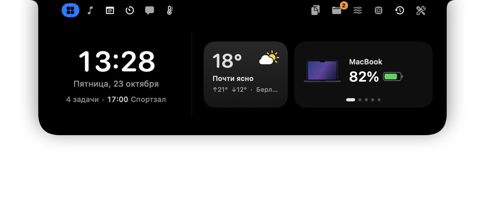
  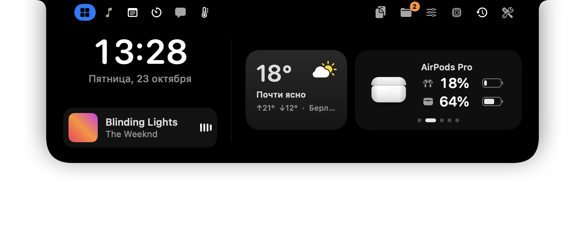
</p>

### Музыка

Крупная обложка со свечением в цвет кавера, трек и исполнитель, перематываемая полоса прогресса, назад / плей-пауза / вперёд и повтор одной песни. Быстрое переключение между **Apple Music, Spotify и YouTube Music** (в браузере); если ничего не играет, один клик запускает любой из них. Работает с любым приложением, которое отдаёт Now Playing в macOS — включая macOS 15.4+, где системный API закрыт для сторонних приложений (см. [Инженерные детали](#инженерные-детали)).

<p align="center">
  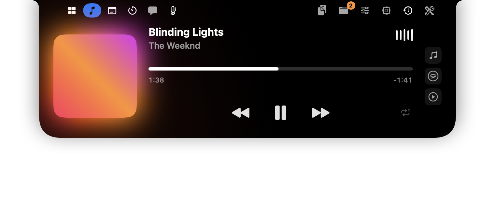
  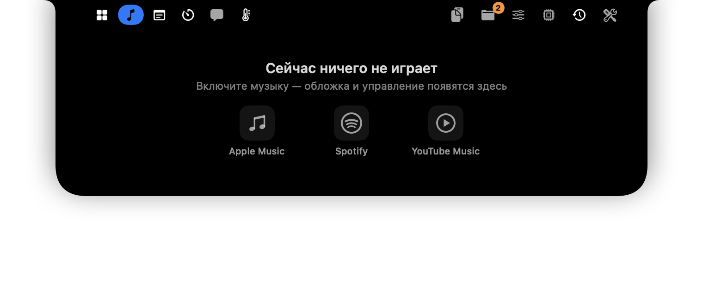
</p>

### Заметки и задачи

**Заметки** — список заметок с богатым редактором: жирный, курсив, зачёркивание, размер текста. Сохраняются по мере набора.

**Задачи** — недельный планировщик (Сегодня, Завтра, затем дни недели) со свайпами между днями. У задачи есть время и описание; ссылки в описании становятся кнопками. Недоделанные задачи прошлых дней сами переезжают в «Сегодня». Любая задача может запустить привязанный Помодоро.

**Ассистент Gemini** — напишите планы обычным языком («зал в 5, звонок в 10»), и он превратит их в короткие задачи со временем; на вопрос придёт короткий ответ. Отвечает на языке интерфейса, нужен свой бесплатный ключ Gemini API, он хранится в Keychain.

<p align="center">
  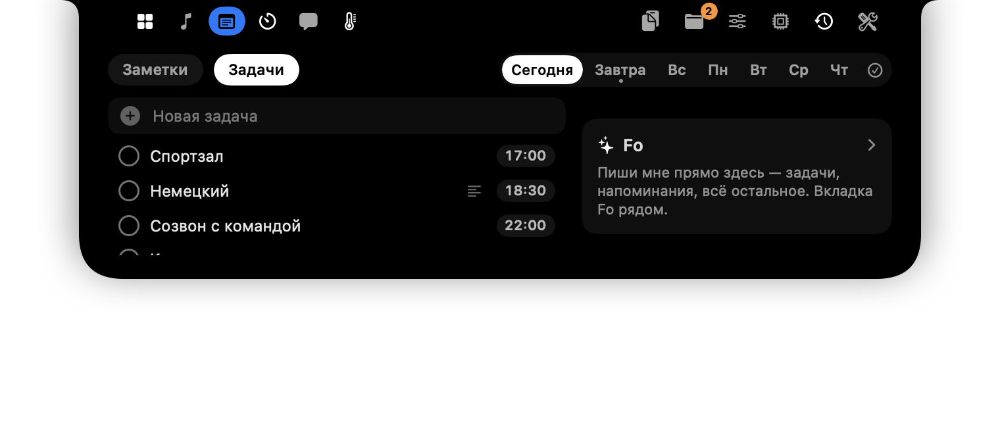
  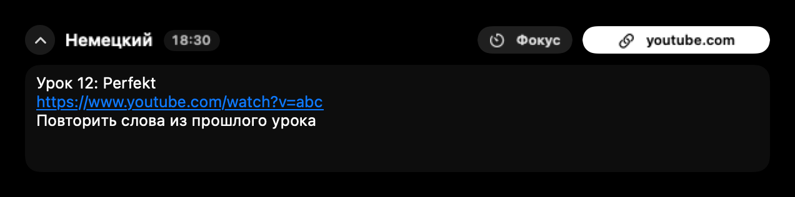
</p>

### Таймер, Помодоро и будильники

- **Помодоро** — 25 минут работы, 5 минут перерыв, 15 минут после каждого четвёртого круга; точки показывают прогресс, круги считаются за день. Можно привязать к задаче. Пока вы фокусируетесь, уведомления молчат, а на перерыве приходит одна сводка.
- **Таймер** — пресеты (1, 5, 10, 15, 30, 60 мин) или любое время до секунды: стрелками или просто цифрами. Когда прозвенел: *Ещё раз* или *Готово*.
- **Будильники** — список с выключателями; когда звонит, можно *Стоп* или *+5 мин*.
- Идущий таймер живёт в **свёрнутом островке** как кольцо прогресса и обратный отсчёт.

<p align="center">
  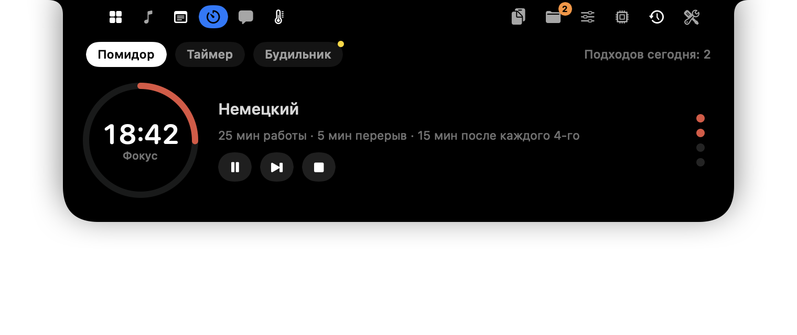
  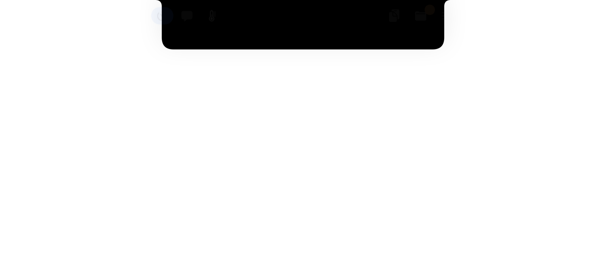
</p>
<p align="center">
  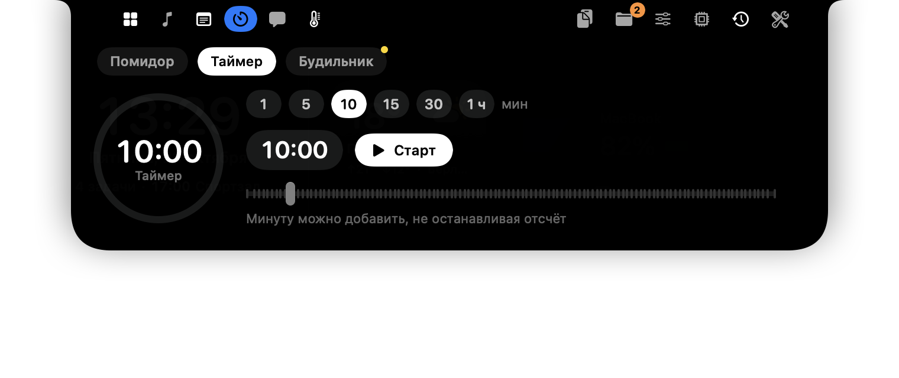
  
</p>

### Напоминания

За 10 и 5 минут и ровно в начале задачи со временем или события календаря из выреза выпадает карточка с мягким синтезированным звоном:

- **Зайти** открывает ссылки Zoom, Google Meet, Microsoft Teams, FaceTime или Яндекс Телемост, найденные в событии;
- **+5 мин** откладывает напоминание;
- **Готово** отмечает задачу выполненной.

Напоминания не повторяются и не вываливаются все сразу после долгого сна Мака. Задача сразу после полуночи всё равно получает свои напоминания вечером накануне.

<p align="center">
  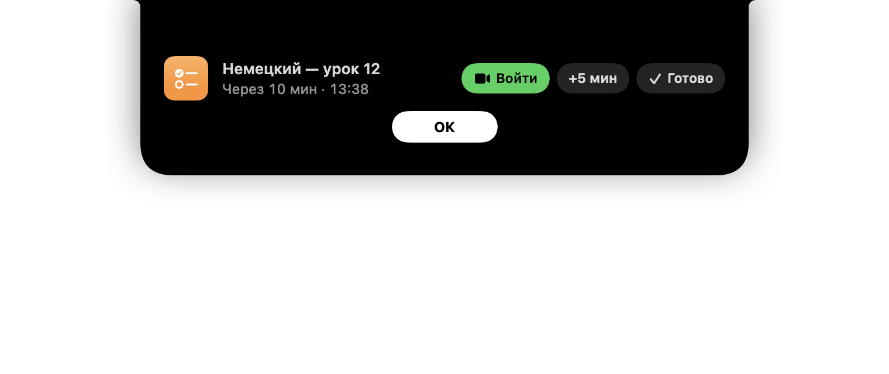
  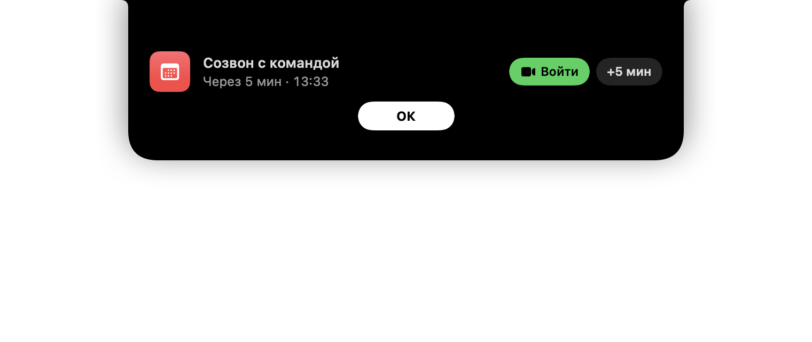
</p>

### AirPods и батареи

Когда наушники подключаются, островок показывает вкладыши и кейс с кольцами заряда, как на iPhone; клик открывает полный лист. Поддержаны AirPods Pro, AirPods, AirPods Max и Beats; каждая подключённая пара получает свою карточку на «Главном». Зарядка показывает карточку с уровнем MacBook.

<p align="center">
  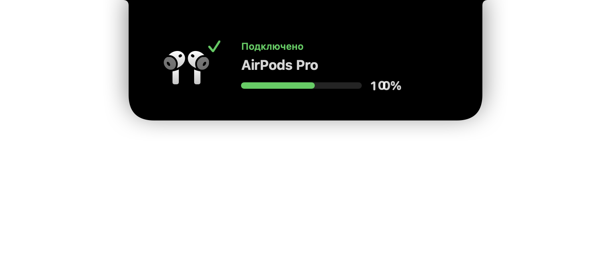
  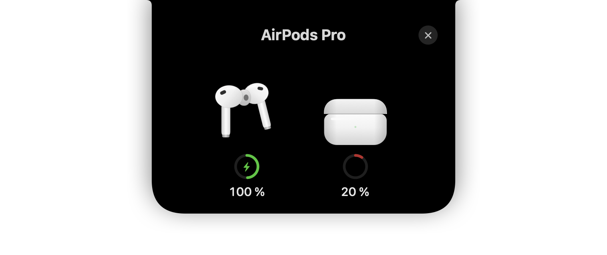
</p>
<p align="center">
  
  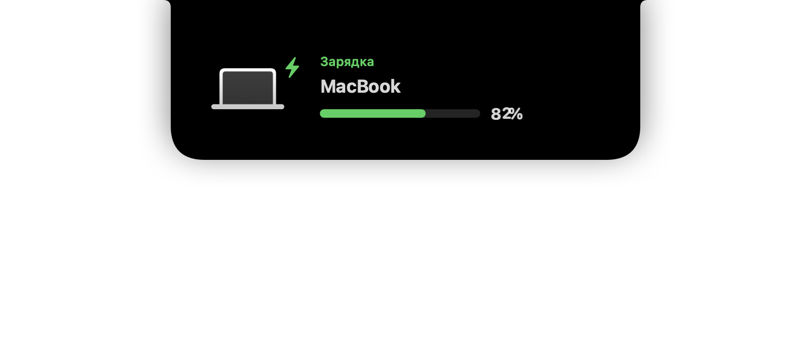
</p>

### Управление

Слайдеры громкости и яркости и **микшер по приложениям**: каждое играющее приложение получает свой слайдер от 0 до 100 %, построенный на process taps Core Audio. Клавиши громкости и яркости показывают HUD самого TinyNotch в вырезе вместо системного.

<p align="center">
  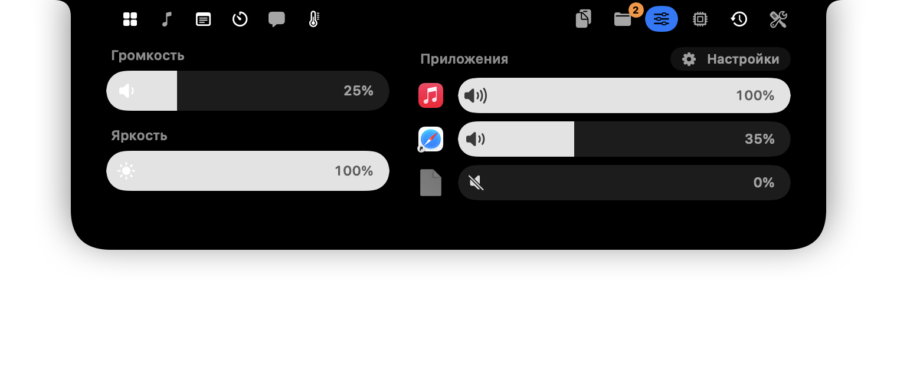
  
</p>

### Файлы

Полка для файлов: бросьте файлы на вырез, чтобы держать их под рукой, и вытягивайте их в любое приложение. Вкладка — две панели рядом: зона броска и полка, со счётчиком файлов, кнопкой **Очистить** и **AirDrop** в контекстном меню. Двойной клик открывает файл; в меню также Открыть, Показать в Finder и Копировать путь.

<p align="center">
  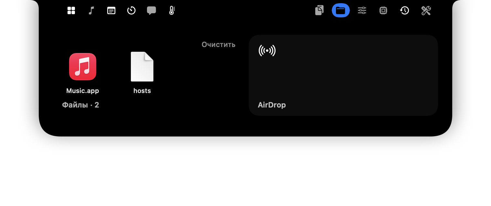
</p>

### Буфер обмена

- **История** — скопированный текст по приложениям, со временем; клик копирует снова, записям можно дать свои имена, удалять по одной или очистить всё. Записи менеджеров паролей не записываются.
- **Скриншоты** — скриншоты в буфер (⌃⇧⌘4) и скопированные картинки хранятся несколько дней: клик копирует, можно перетащить в приложение, сохранить копию, переименовать. Скриншоты Рабочего стола — опционально.
- **API-ключи** — хранилище ключей и токенов за Touch ID или паролем Мака, данные лежат в Keychain.

<p align="center">
  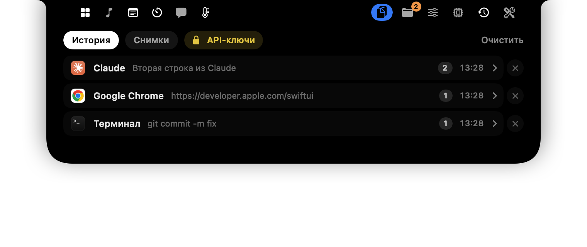
  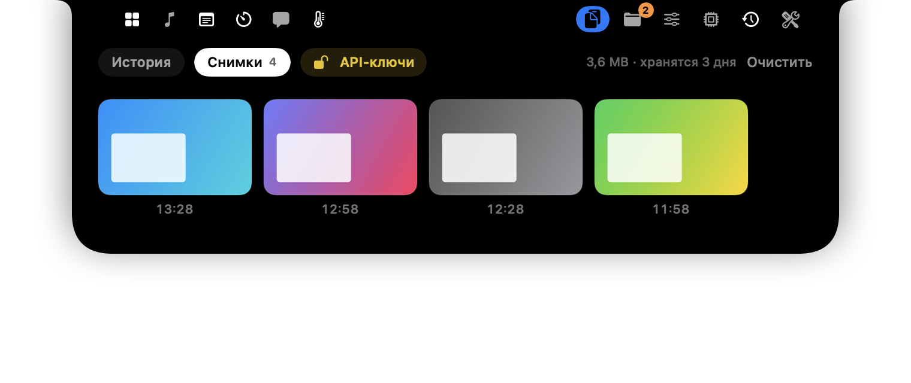
</p>
<p align="center">
  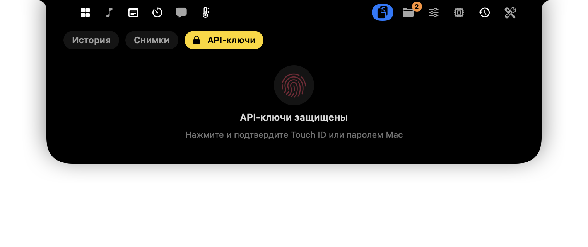
</p>

### Инструменты: 100 в островке

Сетка из **ста утилит** на карточках с чипами категорий и мгновенным поиском — текст, калькуляторы, медиа, система, код и бытовые мелочи. Полный список — в [FEATURES_100.md](FEATURES_100.md); инструменты собраны в пакеты, которые можно спрятать в настройках. По вкусу:

- **Текст** — чистка вставленного текста от форматирования, счётчики, регистр и транслитерация, Base64, URL-кодирование, JSON-форматтер, SHA-256, генераторы UUID и паролей, regex-тестер, diff, морзе и римские цифры;
- **Счёт** — калькулятор с историей, единицы, валюты (кэш курсов), проценты, кредитный платёж, монетка и кубик;
- **Медиа** — конвертер картинок в PNG/JPEG/HEIC/PDF с изменением размера и сжатием, слияние/разделение/сжатие PDF, видео в аудио или GIF, пакетное переименование;
- **Система** — монитор CPU/RAM/сети, место на дисках, циклы батареи, аптайм, список Wi-Fi, память по процессам с убийством, «не спать», тёмная тема и «Не беспокоить»;
- **Код** — git-статус и лог, счётчик TODO, локальный HTTP-сервер на папке, кто слушает порт, SQL-билдер и форматтер, расшифровка cron;
- **Инфо и быт** — погода, курсы валют, чеклист покупок, ленты RSS и Hacker News, ближайшие дни рождения, счётчик воды, дыхание 4-7-8, цитата и шутка дня, статистика Помодоро;
- **Игры** — 2048, Змейка, Сапёр и тамагочи-котик прямо в вырезе.

Длинным выводам нужно место: потяните за **серую полоску внизу** островка — он растянется, а размер запомнится.

### Конвертер файлов

Бросьте файл на островок (или откройте конвертер в Инструментах) — он станет карточкой с действиями: **Сжать**, **Размер**, конвертация в **PNG / JPEG / PDF** и **чистка метаданных**; ценное сразу уходит на полку. Всё делается локально системными фреймворками — наружу не уходит ничего.

### Агенты

TinyNotch следит за вашими ИИ-сессиями (opencode и другие). Запущенные сессии появляются во вкладке **Агенты** сами, команду или вопрос агенту можно кинуть прямо из островка, а пока агент ждёт вашего подтверждения, у края выреза пульсирует маленькая лампочка — агент не повиснет незамеченным.

<p align="center">
  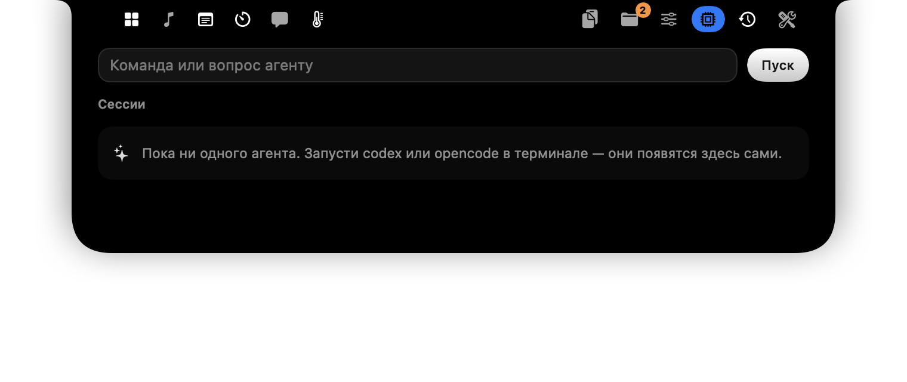
</p>

### Температуры

Температуры ядер CPU из датчиков SMC Мака прямо в островке (встроенный хелпер `smctemp`, ничего ставить не нужно).

<p align="center">
  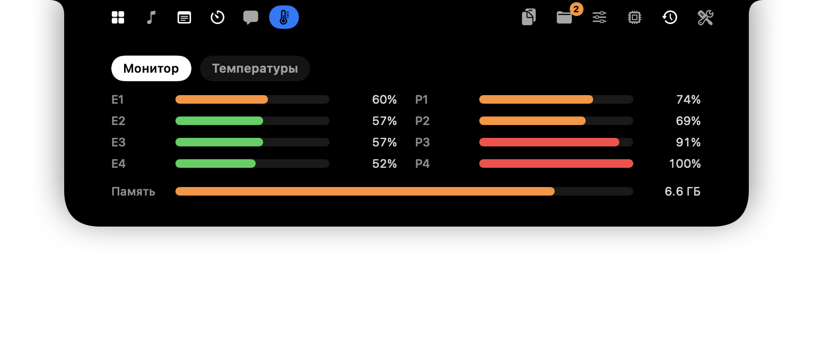
</p>

### Монитор Bambu Lab

Живой статус вашего принтера Bambu Lab по локальной сети: что принтер делает и насколько продвинулась печать.

### Свёрнутый островок

Даже закрытым островок показывает важное рядом с вырезом: обложку и эквалайзер, пока играет музыка, название нового трека, HUD громкости/яркости, «Скопировано», кольца таймера и Помодоро, батарею наушников — и карточки событий: напоминания, будильники, конец таймера или фокус-сессии.

<p align="center">
  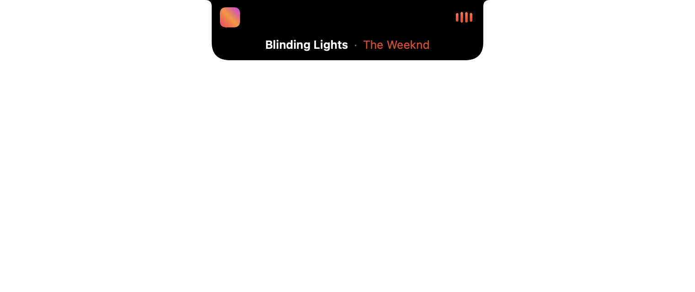
  
</p>
<p align="center">
  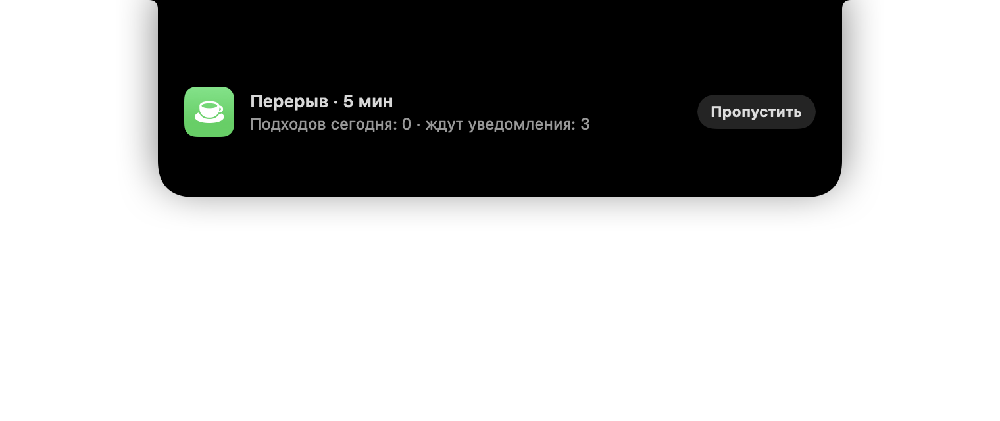
  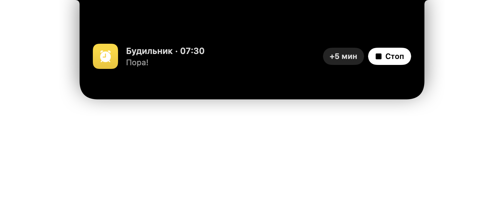
</p>

### Настройки

Отдельное окно, которое открывается прямо под островком, поэтому каждое изменение видно вживую:

- **Общие** — язык (русский / английский), запуск при входе, иконка в строке меню, вкладка, на которой островок открывается, сколько живёт после ухода курсора;
- **Вкладки** — порядок, сторона выреза (лево / право) и видимость каждой вкладки;
- **Островок** — активность музыки, подглядывание названия трека, HUD вместо системного, «Скопировано», карточки зарядки и наушников;
- **Буфер** — история текста и срок хранения, скриншоты, скриншоты Рабочего стола, занятое место;
- **О программе** — версия и выход.

<p align="center">
  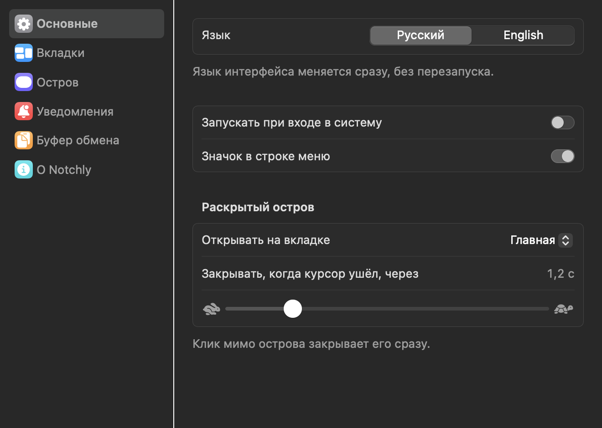
  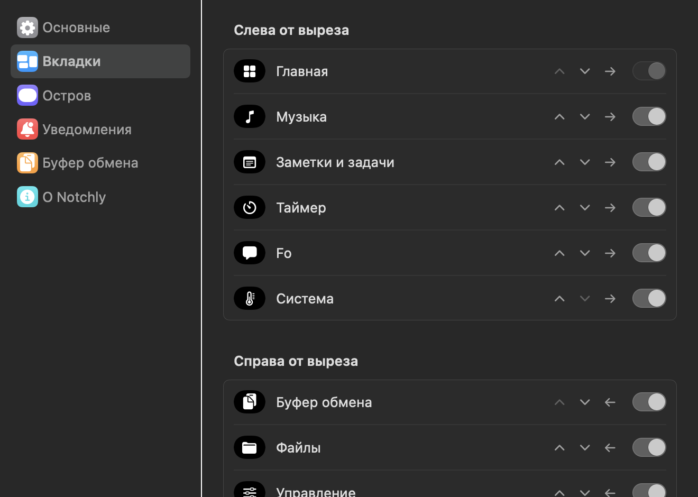
</p>

## Приватность

Всё остаётся на вашем Маке: никакого сервера, аналитики и телеметрии. Секреты живут только в Keychain (только это устройство), хранилище API-ключей за Touch ID, файлы данных только для владельца, буфер пропускает записи менеджеров паролей, открываются только веб-ссылки, разрешения запрашиваются только когда функция впервые нужна. Конвертер файлов не загружает ничего наружу. Подробности и полный список сетевых вызовов: **[PRIVACY.md](PRIVACY.md)**.

## Требования

- MacBook с вырезом (остальные Маки получают плавающую таблетку), **macOS 14 Sonoma или новее**; разработано на Apple Silicon, собирается как универсальное приложение.
- Для сборки: Command Line Tools (`xcode-select --install`). Xcode не нужен.

## Сборка и запуск

```bash
git clone https://github.com/Zyrqon/tinynotch.git && cd tinynotch
./scripts/setup-signing.sh   # один раз: локальный сертификат подписи, чтобы разрешения переживали пересборки
./build.sh                   # универсальная сборка приложения
open build/Notchly.app
```

| Скрипт | Что делает |
|---|---|
| `./build.sh` | собирает универсальное `build/Notchly.app`, кладёт медиа-адаптер, подписывает |
| `./scripts/make-dmg.sh` | собирает `TinyNotch.dmg` для релиза |
| `./scripts/update-screenshots.sh` | перерисовывает скриншоты README на обоих языках |
| `swift scripts/make-icon.swift` | пересоздаёт иконку приложения |
| `python3 scripts/check-l10n.py` | проверяет, что у каждой строки интерфейса есть английский перевод |

### Разрешения

Каждое разрешение опционально и запрашивается только при первом использовании; без него TinyNotch просто прячет эту функцию.

| Разрешение | Зачем |
|---|---|
| Универсальный доступ | перехват клавиш громкости/яркости, чтобы строка меню не наползала на островок |
| Захват звука | микшер по приложениям (звук масштабируется, никогда не записывается) |
| Календари | напоминания о встречах |
| Bluetooth | батарея наушников |
| Геолокация | местная погода (иначе примерно, по IP) |
| Папка «Рабочий стол» | хранение скриншотов Рабочего стола (только если включите) |

## Инженерные детали

- **Now Playing на macOS 15.4+.** `MediaRemote` закрыт для сторонних приложений, поэтому крошечная dylib (`MediaAdapter/`) загружается в системный `/usr/bin/perl`, у которого entitlement ещё есть, и стримит состояние плеера JSON-строками. Запасной путь — AppleScript.
- **Громкость по приложениям.** Process taps Core Audio + приватное aggregate-устройство. Тапы создаются только для приложений ниже 100 %, список процессов обновляется на месте, поэтому звук не перезапускается. Хелпер-процессы сворачиваются в родителя через `responsibility_get_pid_responsible_for_pid`; слушатели Core Audio заменяют опрос.
- **Анимации без прыжков раскладки.** Содержимое островка живёт на неподвижном, центрированном холсте; анимируется только чёрная форма (фон + маска), поэтому виды никогда не съезжают вбок, а текст не масштабируется и не плывёт. Бесконечные анимации (эквалайзер, shimmer, пульс) идут на Core Animation, поэтому простаивающий островок почти не тратит CPU.
- **Слежка за агентами без хуков.** Сессии читаются из собственного хранилища opencode, поэтому мониторинг работает, где бы агент ни был запущен; `CGEventTap` не даёт строке меню наползать на островок и перехватывает клавиши громкости/яркости.
- **Глобальные хоткеи без Универсального доступа.** Хоткеи регистрируются через Carbon `RegisterEventHotKey`, разрешение не нужно вовсе.
- **Конвертация полностью локальная.** Действия с картинками, PDF и видео идут на системных фреймворках (`CoreGraphics`, `PDFKit`, `AVFoundation`), без ffmpeg и без сети.
- **Без Xcode.** Swift Package + Command Line Tools. `build.sh` собирает универсальный `.app`, кладёт медиа-адаптер и подписывает стабильным локальным сертификатом, чтобы разрешения macOS переживали пересборки.
- **Headless-проверки интерфейса.** `Notchly --snapshots <dir>` рендерит каждое состояние островка в PNG — каждый скриншот этого README сделан так, на обоих языках.

### Самопроверки

```bash
swift build
.build/debug/Notchly --snapshots /tmp/notchly --lang ru   # отрендерить все состояния в PNG
.build/debug/Notchly --gif docs/notchly.gif --lang ru     # анимация README, покадрово
.build/debug/Notchly --reminders-selftest                  # планирование напоминаний, включая через полночь
.build/debug/Notchly --mixer-selftest                      # какие приложения играют звук
.build/debug/Notchly --batteries-selftest                  # подключённые устройства и их заряд
.build/debug/Notchly --bench                               # нагрузка CPU островка в типичных состояниях
.build/debug/Notchly --chime                               # проиграть звук напоминания
python3 scripts/check-l10n.py                              # переводы полные
```

## Структура проекта

```
Sources/Notchly/
  App.swift                      точка входа, иконка в строке меню, флаги самопроверок
  IslandModel.swift              автомат состояний островка и тайминги анимаций
  NotchWindowController.swift    панель над вырезом, наведение и клики
  MediaController.swift          now playing (медиа-адаптер + запасной AppleScript)
  ScriptablePlayers.swift        управление Apple Music / Spotify
  AppAudioMixer.swift            громкость по приложениям на process taps Core Audio
  SystemControls.swift           громкость, яркость, HUD
  MediaKeyInterceptor.swift      CGEventTap для клавиш громкости
  MenuBarGuard.swift             не даёт строке меню закрыть островок
  Reminders.swift                напоминания, календарь, мягкий звон
  Focus.swift, ClockTimers.swift Помодоро, таймер, будильники
  Stores.swift                   задачи, заметки, полка файлов; миграция данных
  ClipboardMonitor.swift         история буфера обмена
  ScreenshotStore.swift          скриншоты и скопированные картинки
  KeyVault.swift, Keychain.swift хранилище API-ключей за Touch ID
  DeviceBatteryMonitor.swift     батареи MacBook, AirPods и аксессуаров
  WeatherService.swift           погода Open-Meteo и геолокация
  GeminiAssistant.swift          планы → задачи через Gemini
  Settings.swift                 настройки пользователя
  Features/                      сетка инструментов, пакеты, детали инструментов
  FileConverter.swift            локальная конвертация файлов
  AgentsMonitor.swift, AgentRunner.swift, AgentPermission.swift   ИИ-сессии
  FoChat.swift                   чат с ассистентом внутри островка
  BambuMonitor.swift             статус принтера Bambu Lab по локальной сети
  TempsTab.swift, StatusHub.swift  температуры CPU и статус системы
  MemoryJanitor.swift, UnlockWatcher.swift, Hotkeys.swift  память, события разблокировки, глобальные хоткеи
  Localization.swift, English.swift  поиск L(...) и английская таблица
  Snapshots.swift, ReadmeGIF.swift, Bench.swift  headless-рендеры и бенчмарки
  Views/                         SwiftUI-виды для каждой вкладки, карточки и окна настроек
MediaAdapter/                    dylib, загружаемая в /usr/bin/perl для Now Playing
Resources/                       Info.plist, иконка, локализованное имя приложения
scripts/                         подпись, иконка, .dmg, скриншоты, проверка переводов
docs/                            иконка, анимация и скриншоты (en / ru)
```

## Благодарности

TinyNotch построен на отличном опенсорсном **[Notchly](https://github.com/oleksandrsenko/Notchly)** Олега Сенко… вернее, Oleksandr Senko (MIT). Движок островка, медиа-адаптер, буфер обмена и системный стек — оттуда; островок инструментов, конвертер файлов, слежка за агентами, температуры, монитор принтера и остальные новые вкладки разработаны в этом форке. [LICENSE](LICENSE) сохраняет исходную атрибуцию.

## Лицензия

[MIT](LICENSE)

---

<sub>TinyNotch не является продуктом Apple. «Dynamic Island», AirPods, Apple Music и FaceTime — торговые марки Apple Inc.; остальные названия принадлежат их владельцам.</sub>
